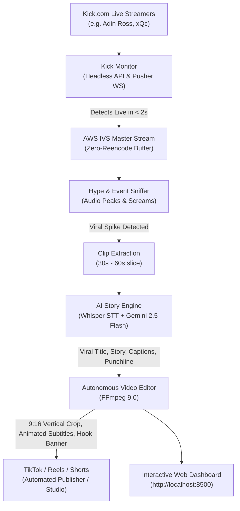

# 🚀 Kick AI Clip Engine & Autonomous Social Publisher

An ultra-lightweight, automated system to monitor **Kick.com** live streamers, detect viral hype moments and story arcs using AI, auto-crop into **9:16 vertical TikTok/Reels format** with dynamic animated subtitles & hook banners, and auto-publish to social media.

---

## ⚡ क्यों यह आपके PC पर बिल्कुल "हल्का" (Lightweight) है?

| Approach | Traditional Screen Capture (भारी / Heavy) | Kick AI Clip Engine (अल्ट्रा-लाइटवेट / Lightweight) |
| :--- | :--- | :--- |
| **तरीका** | 24/7 ब्राउज़र और OBS/स्क्रीन रिकॉर्डर खुला रखना | **Direct Headless Ingestion**: Kick API + AWS IVS `.m3u8` स्ट्रीम-कॉपी |
| **CPU/GPU लोड** | **60% - 90%** (भारी पंखे, लैग) | **< 1% CPU** (स्ट्रीम कॉपी में कोई वीडियो री-एनकोडिंग नहीं होती) |
| **स्क्रीन की पाबंदी**| स्क्रीन हमेशा खुली रखनी पड़ती है, मिनिमाइज़ नहीं कर सकते | **0% स्क्रीन डिस्टर्बेंस** (बैकग्राउंड में शांति से चलता है) |
| **क्वालिटी** | स्क्रीन रेजोल्यूशन पर निर्भर, लैग और फ्रेम ड्रॉप्स | **क्रिस्टल क्लियर 1080p 60fps** डायरेक्ट सोर्स वीडियो |
| **AI डिटेक्शन** | पूरे 6 घंटे का भारी वीडियो फ्रेम-बाय-फ्रेम प्रोसेस करना | **स्मार्ट इवेंट ट्रिगर्स**: ऑडियो डेसिबल पीक (चीखना/हंसना) + चैट स्पाइक्स |

---

## 🏗️ सिस्टम आर्किटेक्चर (System Architecture)



---

## 📂 प्रोजेक्ट फ़ाइल स्ट्रक्चर

- `main.py`: मास्टर रनर जो डैशबोर्ड और बैकग्राउंड मॉनिटर को 1-क्लिक में शुरू करता है।
- `kick_monitor.py`: बिना किसी ब्राउज़र लोड के लाइव स्ट्रीम का पता लगाता है और 10-मिनट का रोलिंग बफ़र मेंटेन करता है।
- `hype_detector.py`: स्ट्रीम के ऑडियो वॉल्यूम स्पाइक्स (सक्रीम्स, लाफ्टर, हाइप) को 0.2 सेकंड में मापता है।
- `ai_story_engine.py`: Google Gemini और लोकल Whisper का इस्तेमाल करके क्लिप की पूरी स्टोरी, पंचलाइन, वायरल टाइटल, हुक बैनर और कैप्शंस निकालता है।
- `clip_editor.py`: 16:9 हॉरिजॉन्टल वीडियो को 9:16 वर्टिकल टिकटॉक फॉर्मैट में बदलता है, एनिमेटेड वर्ड-बाय-वर्ड सबटाइटल्स और टॉप बैनर लगाता है।
- `screen_controller.py`: प्लेराइट (Playwright) बेस्ड स्क्रीन/ब्राउज़र एजेंट जो किक प्लेयर को आगे-पीछे (Scrub) कर सकता है और टिकटॉक पर ऑटो-अपलोड कर सकता है।
- `web_dashboard.py`: लोकल फास्टएपीआई (FastAPI) वेब कंट्रोल सेंटर (`http://localhost:8500`)।
- `database.py`: सभी स्ट्रीमर्स, डिटेक्टेड क्लिप्स और सिस्टम लॉग्स को स्टोर करने वाला SQLite डेटाबेस।
- `config.py`: सिस्टम की केंद्रीय सेटिंग्स।

---

## 🛠️ कैसे शुरू करें (Quick Start)

### 1. फोल्डर में जाएं
```powershell
cd C:\Users\MSI\.gemini\antigravity\scratch\kick-ai-clip-engine
```

### 2. (वैकल्पिक) Gemini API Key जोड़ें
`.env.example` को कॉपी करके `.env` बनाएं और अपनी फ्री Gemini API Key डालें:
```env
GEMINI_API_KEY=your_gemini_api_key_here
VIDEO_LAYOUT=blurred_backdrop
```
*(नोट: यदि API Key नहीं भी है, तब भी यह सिस्टम बिल्ट-इन लोकल Whisper और स्मार्ट ह्यूरिस्टिक इंजन के साथ 100% काम करता है!)*

### 3. सिस्टम चालू करें
```powershell
python main.py
```
यह कमांड तुरंत आपका वेब डैशबोर्ड `http://localhost:8500` पर आपके डिफ़ॉल्ट ब्राउज़र में खोल देगा!

---

## 🎮 डैशबोर्ड में क्या-क्या कर सकते हैं?
1. **Streamer Watchlist**: नए स्ट्रीमर्स जोड़ें या हटाएं। उनका लाइव स्टेटस, व्यूअर्स और टाइटल तुरंत दिखता है।
2. **Instant Clip Trigger**: किसी भी लाइव स्ट्रीमर का पिछला 30s, 45s या 60s का क्लिप 1-क्लिक में निकालें।
3. **Player Scrub**: स्ट्रीमर के स्ट्रीम को 30 सेकंड पीछे (Rewind) या आगे (Forward) करें।
4. **Vertical Video Studio**: तैयार 9:16 टिकटॉक वीडियो को सीधे वेब प्लेयर में देखें (वर्ड-बाय-वर्ड सबटाइटल्स और टॉप हुक बैनर के साथ)।
5. **Publish to TikTok**: 1-क्लिक से टिकटॉक स्टूडियो में वीडियो और कैप्शंस ऑटो-फिल करके पब्लिश करें।
6. **Resource Telemetry**: डैशबोर्ड के टॉप पर रियल-टाइम CPU और RAM यूसेज देख सकते हैं कि यह कितना हल्का चल रहा है।
