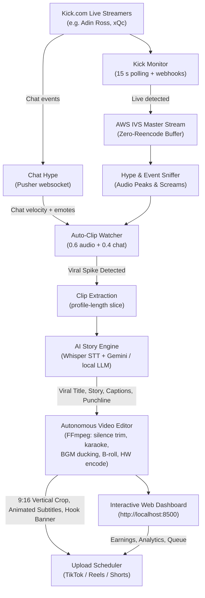

# 🚀 Kick AI Clip Engine & Autonomous Social Publisher

An ultra-lightweight, automated system to monitor **Kick.com** live streamers, detect viral hype moments and story arcs using AI, auto-crop into **9:16 vertical TikTok/Reels format** with hook banners (subtitles off by default — opt in with `ENABLE_SUBTITLES=true`), and auto-publish to social media.

---

## ✨ What's new in v1.1.0 — Live Clipping Upgrades

Seventeen new features plus a Tier 5 of rendering upgrades borrowed from
[opensource-clipping](https://github.com/NaufalRizqullah/opensource-clipping).
Everything is off by default — the engine behaves exactly as before until
you opt in via `.env`. See [CHANGELOG.md](CHANGELOG.md) for the full list.

**Tier 1 — Live core**
1. **Auto-clip watcher** — clips hype moments automatically, no button click (`AUTO_CLIP_ENABLED=true`).
2. **Live chat hype** — Kick chat via Pusher websocket feeds the hype score (`CHAT_HYPE_ENABLED=true`).
3. **Kick webhooks** — instant live detection via `livestream.status.updated` (`/api/webhooks/kick`).
4. **Clip cooldown + duplicate protection** — no double-clips of the same moment.

**Tier 2 — Reach & money**
5. **YouTube Shorts uploader** — real YouTube Data API v3 uploads.
6. **Instagram Reels uploader** — Meta Graph API (needs a publicly reachable video URL).
7. **Upload scheduler** — spaced, capped, retrying upload queue per platform.
8. **Earnings tracker + analytics** — Kick-program submissions, CPM earnings, and a feedback loop that recommends your best AI-score threshold.

**Tier 3 — Better clips**
9. **Dead-space removal** — Whisper word timestamps cut silent gaps; subtitles are remapped to match when subtitles are enabled.
10. **Auto-thumbnails** — best frame + hook text, saved next to every render.
11. **Per-streamer profiles** — clip length and layout per streamer (`streamer_profiles.json`).
12. **Whisper config** — tiny/small/medium, CPU/GPU switch (`WHISPER_MODEL`, `WHISPER_DEVICE`).
13. **Multi-streamer detection** — picks the lowest-CPM streamer for Kick-program submission (POV rule).

**Tier 4 — Reliability**
14. **Docker** — `Dockerfile` + `docker-compose.yml`; cross-platform fonts/paths (no more Windows-only paths).
15. **Dashboard login** — password + session cookies; SSL verification fixed (no more `CERT_NONE`).
16. **Discord / Telegram alerts** — live, clip-ready, upload done/failed.
17. **Retry + resume + CI** — checkpoints let a failed clip resume mid-pipeline (`/api/clips/{id}/retry`); GitHub Actions runs the test suite.

**Tier 5 — Rendering upgrades**
- MediaPipe/YOLO face tracking (Haar fallback), kinetic karaoke subtitles (`SUBTITLE_STYLE=karaoke`, only when subtitles are enabled via `ENABLE_SUBTITLES=true`), camera-switch + split-screen layouts, Pexels B-roll, background music with sidechain ducking (`BGM_ENABLED=true`), NVENC/AMF/VAAPI encoder auto-detect (verified with a test encode), and an LLM fallback chain (Gemini → local OpenAI-compatible model → heuristic).

**Cross-platform + Android phone**
- Runs on **Windows, macOS and Linux** (same code, `platform_utils.py` handles fonts/paths per OS) — `start.sh` for Mac/Linux, `start.bat`/`start_engine.bat` for Windows, Docker unchanged. The dashboard is **phone-friendly**: open it from your Android browser on the same Wi-Fi (`--host 0.0.0.0`, see below).

## ⚡ Why is it so "lightweight" on your PC?

| Approach | Traditional Screen Capture (Heavy) | Kick AI Clip Engine (Ultra-Lightweight) |
| :--- | :--- | :--- |
| **Method** | Keep a browser and OBS/screen recorder open 24/7 | **Direct Headless Ingestion**: Kick API + AWS IVS `.m3u8` stream-copy |
| **CPU/GPU load** | **60% - 90%** (loud fans, lag) | **< 1% CPU** (stream copy involves no video re-encoding) |
| **Screen restriction** | Screen must stay open all the time, can't minimise | **0% screen disturbance** (runs quietly in the background) |
| **Quality** | Depends on screen resolution, lag and frame drops | **Crystal-clear 1080p 60fps** direct source video |
| **AI detection** | Process a full 6 hours of heavy video frame-by-frame | **Smart event triggers**: audio decibel peaks (screaming/laughing) + chat spikes |

---

## 🏗️ System Architecture



---

## 📂 Project File Structure

- `main.py`: Master runner that starts the dashboard and background monitor in 1 click.
- `kick_monitor.py`: Detects live streams with no browser load and maintains a 10-minute rolling buffer.
- `hype_detector.py`: Measures audio volume spikes in the stream (screams, laughter, hype) in 0.2 seconds.
- `ai_story_engine.py`: Uses Google Gemini and local Whisper to extract the clip's full story, punchline, viral title, hook banner and captions.
- `clip_editor.py`: Converts 16:9 horizontal video to 9:16 vertical TikTok format, adds a top hook banner that shows for the first 4 seconds only (then fades out; the Kick bar stays visible), and word-by-word subtitles only when subtitles are enabled.
- `screen_controller.py`: Playwright-based screen/browser agent that can scrub the Kick player back and forth and auto-upload to TikTok.
- `web_dashboard.py`: Local FastAPI web control centre (`http://localhost:8500`).
- `database.py`: SQLite database storing all streamers, detected clips and system logs.
- `config.py`: The system's central settings.
- `auto_clip_watcher.py` (Tier 1): Background thread that automatically creates clips on hype moments.
- `chat_hype.py` (Tier 1): Live hype score from Kick chat (Pusher websocket).
- `kick_webhooks.py` (Tier 1): Kick webhook receiver + subscription helper (instant live detection).
- `clip_dedup.py` (Tier 1): Clip cooldown and duplicate protection.
- `youtube_uploader.py` / `instagram_uploader.py` (Tier 2): YouTube Shorts and Instagram Reels uploaders.
- `upload_scheduler.py` (Tier 2): Spaced, capped, retrying upload queue.
- `earnings.py` / `analytics.py` / `dashboard_routers.py` (Tier 2): Kick programme earnings, performance feedback and their API routes.
- `silence_cutter.py` / `thumbnail.py` / `streamer_profiles.py` / `streamer_detection.py` (Tier 3): Dead-space cutting, auto-thumbnails, per-streamer profiles, multi-streamer detection.
- `auth.py` / `alerts.py` / `retry_utils.py` (Tier 4): Dashboard login, Discord/Telegram alerts, retry + checkpoint resume.
- `karaoke_subtitles.py` / `render_modes.py` / `broll.py` / `bgm.py` / `encoder.py` / `llm_providers.py` (Tier 5): Kinetic karaoke subtitles, camera-switch/split-screen, B-roll, background music, hardware encoder detection, LLM fallback.
- `Dockerfile` / `docker-compose.yml` (Tier 4): For running in a container.

---

## 🛠️ Quick Start

### 1. Go to the folder
```powershell
cd <path-to-this-repo>   # where you cloned ai-social-studio
```

### 2. (Optional) Add a Gemini API Key
Copy `.env.example` to `.env` and add your free Gemini API key:
```env
GEMINI_API_KEY=your_gemini_api_key_here
VIDEO_LAYOUT=blurred_backdrop
```
*(Note: even without an API key, the system still works 100% with the built-in local Whisper and smart heuristic engine!)*

### 3. Start the system
```powershell
# Windows:
start_engine.bat        # or: python main.py
# macOS / Linux:
chmod +x start.sh       # only needed once after cloning
./start.sh              # or: python3 main.py
```
This command immediately opens your web dashboard at `http://localhost:8500` in your default browser!

---

## 💻 Windows / macOS / Linux — Setup per platform

The same code runs on all three OSs; fonts and paths come from `platform_utils.py`, per OS.

| Need | Windows | macOS (MacBook) | Linux (Ubuntu) |
|---|---|---|---|
| Python | 3.11+ ([python.org](https://www.python.org/downloads/)) — tick "Add to PATH" during install | `brew install python@3.11` | `sudo apt install python3 python3-pip python3-venv` |
| ffmpeg | Install from [ffmpeg.org](https://ffmpeg.org/download.html) and add to PATH (or `winget install ffmpeg`) | `brew install ffmpeg` | `sudo apt install ffmpeg` |
| Fonts | Windows fonts are found automatically | macOS fonts are found automatically (Impact / Arial Bold) | `sudo apt install fonts-dejavu-core fonts-liberation` (if not already installed) |
| Start | `start_engine.bat` (or `python main.py`) | `./start.sh` (or `python3 main.py`) | `./start.sh` (or `python3 main.py`) |
| 1-click shortcut | `python create_desktop_shortcut.py` → Desktop `.lnk` | → Desktop `.command` (you may need to allow it in Gatekeeper the first time) | → Desktop `.desktop` + app menu (choose "Allow Launching" the first time) |

On first run the launcher installs dependencies itself (if fastapi is not found, it runs `pip install -r requirements.txt`). `start.sh` passes through the `--host`, `--port` and `--no-browser` flags. The desktop app (`desktop_app.py`) also runs on all three OSs: pywebview window first, otherwise browser app-mode (Windows: Edge/Chrome, macOS: Chrome, Linux: Chrome/Chromium).

## 📱 Open the Dashboard from Your Android Phone (Phone browser)

No native app needed — the clipping engine runs on your computer/server and the dashboard opens in your phone's browser (mobile-friendly layout: large tap targets, a header and notifications panel that fit the phone screen).

**Option A — same Wi-Fi (at home/in the office):**
1. On the computer, put `DASHBOARD_HOST=0.0.0.0` and `DASHBOARD_PASSWORD=<your-password>` in `.env` (a password is essential — the dashboard will now be visible to the whole local network).
2. Start the app on the computer — the "On your phone (same Wi-Fi)" line at startup shows the IP, e.g. `http://192.168.1.5:8500`.
3. Open the same address in Chrome on your Android phone (phone and computer on the same Wi-Fi) and log in with the password.

**Option B — on a VPS / server (from anywhere):**
1. Run it on the server with Docker (`docker compose up --build`, already binds to `0.0.0.0:8500`) or `python main.py --host 0.0.0.0 --no-browser`.
2. Open the server's IP/domain + port in the browser (e.g. `http://<your-vps-ip>:8500`) — in production use an HTTPS reverse proxy (nginx/Caddy) + `DASHBOARD_PASSWORD`.

**Tip:** In Chrome, ⋮ → "Add to Home screen" turns the dashboard into a home-screen icon — it opens like a full-screen app.

---

## 🐳 Run with Docker (Docker Quickstart)

```powershell
copy .env.example .env
# put your keys in .env, then:
docker compose up --build
```
The dashboard will be at `http://localhost:8500`. Before the first `up`, the `kick_engine.db` file must exist (an empty file is fine) — otherwise Docker creates a directory in its place. GPU encoding (NVENC) does not work in Docker on Windows; keep `VIDEO_ENCODER=libx264`.

---

## 🔔 Kick Webhooks Setup (Instant Live Detection)

Polling checks the live status every 15 seconds; webhooks tell you the moment a stream goes live.
1. Create an app at [kick.com/settings/developer](https://kick.com/settings/developer) — note down `KICK_CLIENT_ID` and `KICK_CLIENT_SECRET`.
2. Put `KICK_CLIENT_ID`, `KICK_CLIENT_SECRET`, `KICK_ACCESS_TOKEN` and `KICK_WEBHOOK_URL` (your server's public HTTPS URL) in `.env`.
3. Check the checklist at `GET /api/webhooks/status` on the dashboard, then subscribe with `POST /api/webhooks/subscribe`.
4. Webhook endpoint: `POST /api/webhooks/kick` (signature verified with RSA-SHA256).

> Note: it has not been verified whether a user token can subscribe for *other* broadcasters. If Kick refuses, webhooks will only work for your own channel and polling will continue for other streamers — which already works.

---

## ⚙️ Configuration (.env)

All settings are grouped in `.env.example` — with every Tier 1–5 feature. The most important:
- `AUTO_CLIP_ENABLED=true` — turn on auto-clipping (default: off).
- `CHAT_HYPE_ENABLED=true` — turn on chat hype (default: off).
- `DASHBOARD_PASSWORD` or `DASHBOARD_PASSWORD_HASH` — dashboard login (default: open).
- `ENABLE_SUBTITLES=true` — burn subtitles into clips (default: off — Kick clips render with no subtitles; Whisper still transcribes for silence cutting).
- `SUBTITLE_STYLE=karaoke` — kinetic karaoke subtitles (default: classic; only applies when subtitles are enabled).
- `BGM_ENABLED=true` + MP3s in `assets/bgm/<mood>/` — background music (default: off).
- `VIDEO_ENCODER=auto` — NVENC/AMF/VAAPI/libx264 auto-detect (default: auto).
- `DASHBOARD_HOST=0.0.0.0` + `DASHBOARD_PORT=8500` — open the dashboard from the local network / Android phone (default: this computer only).

---

## 🎮 What Can You Do in the Dashboard?
1. **Streamer Watchlist**: Add or remove streamers. Their live status, viewers and title show up instantly.
2. **Instant Clip Trigger**: Extract the last 30s, 45s or 60s clip of any live streamer in 1 click.
3. **Player Scrub**: Rewind or forward the streamer's stream by 30 seconds.
4. **Vertical Video Studio**: Watch the finished 9:16 TikTok video directly in the web player (with top hook banner; subtitles only if enabled).
5. **Publish to TikTok**: Publish in 1 click with video and captions auto-filled in TikTok Studio.
6. **Resource Telemetry**: See real-time CPU and RAM usage at the top of the dashboard to see how light it runs.
7. **Earnings & Analytics**: Kick programme submissions, CPM earnings and AI-score feedback (which threshold performs best).
8. **Upload Queue**: Spaced, capped queue for YouTube / Instagram / TikTok uploads.
9. **Clip Retry**: Resume a failed clip from its last checkpoint (`/api/clips/{id}/retry`).
10. **Webhooks Status**: Kick webhook configuration and setup checklist (`/api/webhooks/status`).
