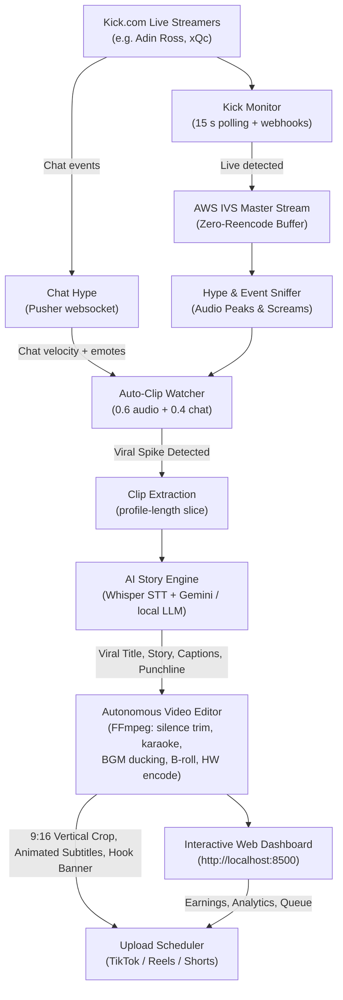

# 🚀 Kick AI Clip Engine & Autonomous Social Publisher

An ultra-lightweight, automated system to monitor **Kick.com** live streamers, detect viral hype moments and story arcs using AI, auto-crop into **9:16 vertical TikTok/Reels format** with dynamic animated subtitles & hook banners, and auto-publish to social media.

---

## ✨ What's new in v1.1.0 — Live Clipping Upgrades

Seventeen new features plus a Tier 5 of rendering upgrades borrowed from
[opensource-clipping](https://github.com/NaufalRizqullah/opensource-clipping).
Everything is off by default — the engine behaves exactly as before until
you opt in via `.env`. See [CHANGELOG.md](CHANGELOG.md) for the full list.

**Tier 1 — Live core**
1. **Auto-clip watcher** — clips hype moments automatically, no button click (`AUTO_CLIP_ENABLED=true`).
2. **Live chat hype** — Kick chat via Pusher websocket feeds the hype score (`CHAT_HYPE_ENABLED=true`).
3. **Kick webhooks** — instant live detection via `livestream.status.updated` (`/api/webhooks/kick`).
4. **Clip cooldown + duplicate protection** — no double-clips of the same moment.

**Tier 2 — Reach & money**
5. **YouTube Shorts uploader** — real YouTube Data API v3 uploads.
6. **Instagram Reels uploader** — Meta Graph API (needs a publicly reachable video URL).
7. **Upload scheduler** — spaced, capped, retrying upload queue per platform.
8. **Earnings tracker + analytics** — Kick-program submissions, CPM earnings, and a feedback loop that recommends your best AI-score threshold.

**Tier 3 — Better clips**
9. **Dead-space removal** — Whisper word timestamps cut silent gaps; subtitles are remapped to match.
10. **Auto-thumbnails** — best frame + hook text, saved next to every render.
11. **Per-streamer profiles** — clip length and layout per streamer (`streamer_profiles.json`).
12. **Whisper config** — tiny/small/medium, CPU/GPU switch (`WHISPER_MODEL`, `WHISPER_DEVICE`).
13. **Multi-streamer detection** — picks the lowest-CPM streamer for Kick-program submission (POV rule).

**Tier 4 — Reliability**
14. **Docker** — `Dockerfile` + `docker-compose.yml`; cross-platform fonts/paths (no more Windows-only paths).
15. **Dashboard login** — password + session cookies; SSL verification fixed (no more `CERT_NONE`).
16. **Discord / Telegram alerts** — live, clip-ready, upload done/failed.
17. **Retry + resume + CI** — checkpoints let a failed clip resume mid-pipeline (`/api/clips/{id}/retry`); GitHub Actions runs the test suite.

**Tier 5 — Rendering upgrades**
- MediaPipe/YOLO face tracking (Haar fallback), kinetic karaoke subtitles (`SUBTITLE_STYLE=karaoke`), camera-switch + split-screen layouts, Pexels B-roll, background music with sidechain ducking (`BGM_ENABLED=true`), NVENC/AMF/VAAPI encoder auto-detect (verified with a test encode), and an LLM fallback chain (Gemini → local OpenAI-compatible model → heuristic).

**Cross-platform + Android phone**
- Runs on **Windows, macOS and Linux** (same code, `platform_utils.py` handles fonts/paths per OS) — `start.sh` for Mac/Linux, `start.bat`/`start_engine.bat` for Windows, Docker unchanged. The dashboard is **phone-friendly**: open it from your Android browser on the same Wi-Fi (`--host 0.0.0.0`, see below).

## ⚡ क्यों यह आपके PC पर बिल्कुल "हल्का" (Lightweight) है?

| Approach | Traditional Screen Capture (भारी / Heavy) | Kick AI Clip Engine (अल्ट्रा-लाइटवेट / Lightweight) |
| :--- | :--- | :--- |
| **तरीका** | 24/7 ब्राउज़र और OBS/स्क्रीन रिकॉर्डर खुला रखना | **Direct Headless Ingestion**: Kick API + AWS IVS `.m3u8` स्ट्रीम-कॉपी |
| **CPU/GPU लोड** | **60% - 90%** (भारी पंखे, लैग) | **< 1% CPU** (स्ट्रीम कॉपी में कोई वीडियो री-एनकोडिंग नहीं होती) |
| **स्क्रीन की पाबंदी**| स्क्रीन हमेशा खुली रखनी पड़ती है, मिनिमाइज़ नहीं कर सकते | **0% स्क्रीन डिस्टर्बेंस** (बैकग्राउंड में शांति से चलता है) |
| **क्वालिटी** | स्क्रीन रेजोल्यूशन पर निर्भर, लैग और फ्रेम ड्रॉप्स | **क्रिस्टल क्लियर 1080p 60fps** डायरेक्ट सोर्स वीडियो |
| **AI डिटेक्शन** | पूरे 6 घंटे का भारी वीडियो फ्रेम-बाय-फ्रेम प्रोसेस करना | **स्मार्ट इवेंट ट्रिगर्स**: ऑडियो डेसिबल पीक (चीखना/हंसना) + चैट स्पाइक्स |

---

## 🏗️ सिस्टम आर्किटेक्चर (System Architecture)



---

## 📂 प्रोजेक्ट फ़ाइल स्ट्रक्चर

- `main.py`: मास्टर रनर जो डैशबोर्ड और बैकग्राउंड मॉनिटर को 1-क्लिक में शुरू करता है।
- `kick_monitor.py`: बिना किसी ब्राउज़र लोड के लाइव स्ट्रीम का पता लगाता है और 10-मिनट का रोलिंग बफ़र मेंटेन करता है।
- `hype_detector.py`: स्ट्रीम के ऑडियो वॉल्यूम स्पाइक्स (सक्रीम्स, लाफ्टर, हाइप) को 0.2 सेकंड में मापता है।
- `ai_story_engine.py`: Google Gemini और लोकल Whisper का इस्तेमाल करके क्लिप की पूरी स्टोरी, पंचलाइन, वायरल टाइटल, हुक बैनर और कैप्शंस निकालता है।
- `clip_editor.py`: 16:9 हॉरिजॉन्टल वीडियो को 9:16 वर्टिकल टिकटॉक फॉर्मैट में बदलता है, एनिमेटेड वर्ड-बाय-वर्ड सबटाइटल्स और टॉप बैनर लगाता है।
- `screen_controller.py`: प्लेराइट (Playwright) बेस्ड स्क्रीन/ब्राउज़र एजेंट जो किक प्लेयर को आगे-पीछे (Scrub) कर सकता है और टिकटॉक पर ऑटो-अपलोड कर सकता है।
- `web_dashboard.py`: लोकल फास्टएपीआई (FastAPI) वेब कंट्रोल सेंटर (`http://localhost:8500`)।
- `database.py`: सभी स्ट्रीमर्स, डिटेक्टेड क्लिप्स और सिस्टम लॉग्स को स्टोर करने वाला SQLite डेटाबेस।
- `config.py`: सिस्टम की केंद्रीय सेटिंग्स।
- `auto_clip_watcher.py` (Tier 1): बैकग्राउंड थ्रेड जो हाइप मोमेंट्स पर अपने आप क्लिप बनाता है।
- `chat_hype.py` (Tier 1): Kick चैट (Pusher websocket) से लाइव हाइप स्कोर।
- `kick_webhooks.py` (Tier 1): Kick webhook receiver + subscription helper (instant live detection)।
- `clip_dedup.py` (Tier 1): क्लिप कूलडाउन और डुप्लिकेट प्रोटेक्शन।
- `youtube_uploader.py` / `instagram_uploader.py` (Tier 2): YouTube Shorts और Instagram Reels अपलोडर।
- `upload_scheduler.py` (Tier 2): स्पेस्ड, कैप्ड, रीट्राई करने वाली अपलोड क्यू।
- `earnings.py` / `analytics.py` / `dashboard_routers.py` (Tier 2): Kick प्रोग्राम अर्निंग्स, परफॉर्मेंस फीडबैक और उनके API रूट्स।
- `silence_cutter.py` / `thumbnail.py` / `streamer_profiles.py` / `streamer_detection.py` (Tier 3): डेड-स्पेस कटिंग, ऑटो-थंबनेल, पर-स्ट्रीमर प्रोफाइल, मल्टी-स्ट्रीमर डिटेक्शन।
- `auth.py` / `alerts.py` / `retry_utils.py` (Tier 4): डैशबोर्ड लॉगिन, Discord/Telegram अलर्ट्स, रीट्राई + चेकपॉइंट resume।
- `karaoke_subtitles.py` / `render_modes.py` / `broll.py` / `bgm.py` / `encoder.py` / `llm_providers.py` (Tier 5): किनेटिक कराओके सबटाइटल्स, कैमरा-स्विच/स्प्लिट-स्क्रीन, B-roll, बैकग्राउंड म्यूज़िक, हार्डवेयर एनकोडर डिटेक्शन, LLM फॉलबैक।
- `Dockerfile` / `docker-compose.yml` (Tier 4): कंटेनर में चलाने के लिए।

---

## 🛠️ कैसे शुरू करें (Quick Start)

### 1. फोल्डर में जाएं
```powershell
cd <path-to-this-repo>   # जहाँ आपने ai-social-studio clone किया है
```

### 2. (वैकल्पिक) Gemini API Key जोड़ें
`.env.example` को कॉपी करके `.env` बनाएं और अपनी फ्री Gemini API Key डालें:
```env
GEMINI_API_KEY=your_gemini_api_key_here
VIDEO_LAYOUT=blurred_backdrop
```
*(नोट: यदि API Key नहीं भी है, तब भी यह सिस्टम बिल्ट-इन लोकल Whisper और स्मार्ट ह्यूरिस्टिक इंजन के साथ 100% काम करता है!)*

### 3. सिस्टम चालू करें
```powershell
# Windows:
start_engine.bat        # या: python main.py
# macOS / Linux:
chmod +x start.sh       # सिर्फ पहली बार चाहिए (only needed once after cloning)
./start.sh              # या: python3 main.py
```
यह कमांड तुरंत आपका वेब डैशबोर्ड `http://localhost:8500` पर आपके डिफ़ॉल्ट ब्राउज़र में खोल देगा!

---

## 💻 Windows / macOS / Linux — सेटअप (Setup per platform)

एक ही code तीनों OS पर चलता है; fonts और paths `platform_utils.py` से OS के हिसाब से मिलते हैं।

| जरूरत | Windows | macOS (MacBook) | Linux (Ubuntu) |
|---|---|---|---|
| Python | 3.11+ ([python.org](https://www.python.org/downloads/)) — install करते समय "Add to PATH" टिक करें | `brew install python@3.11` | `sudo apt install python3 python3-pip python3-venv` |
| ffmpeg | [ffmpeg.org](https://ffmpeg.org/download.html) से install करें और PATH में डालें (या `winget install ffmpeg`) | `brew install ffmpeg` | `sudo apt install ffmpeg` |
| Fonts | Windows Fonts अपने-आप मिल जाते हैं | macOS Fonts अपने-आप मिल जाते हैं (Impact / Arial Bold) | `sudo apt install fonts-dejavu-core fonts-liberation` (अगर न हों तो) |
| Start | `start_engine.bat` (या `python main.py`) | `./start.sh` (या `python3 main.py`) | `./start.sh` (या `python3 main.py`) |
| 1-click shortcut | `python create_desktop_shortcut.py` → Desktop `.lnk` | → Desktop `.command` (पहली बार Gatekeeper allow करना पड़ सकता है) | → Desktop `.desktop` + app menu (पहली बार "Allow Launching" चुनें) |

पहली बार चलाने पर launcher खुद dependencies install कर लेता है (अगर fastapi नहीं मिला तो `pip install -r requirements.txt`)। `start.sh` में `--host`, `--port` और `--no-browser` flags pass-through होते हैं। Desktop app (`desktop_app.py`) भी तीनों OS पर चलती है: pywebview window पहले, नहीं तो browser app-mode (Windows: Edge/Chrome, macOS: Chrome, Linux: Chrome/Chromium)।

## 📱 Android फ़ोन से डैशबोर्ड चलाएं (Phone browser)

कोई native app नहीं चाहिए — clipping engine आपके computer/server पर चलता है और डैशबोर्ड फ़ोन के browser में खुलता है (mobile-friendly layout: बड़ी tap targets, phone screen पर fit होने वाला header और notifications panel)।

**Option A — same Wi-Fi (घर/office में):**
1. Computer पर `.env` में `DASHBOARD_HOST=0.0.0.0` और `DASHBOARD_PASSWORD=<redacted>` डालें (password ज़रूरी है — डैशबोर्ड अब पूरे local network को दिखेगा)।
2. Computer पर app start करें — startup पर "On your phone (same Wi-Fi)" वाली line में IP दिखेगा, जैसे `http://192.168.1.5:8500`।
3. Android फ़ोन के Chrome में वही address खोलें (फ़ोन और computer एक ही Wi-Fi पर हों) और password से login करें।

**Option B — VPS / server पर (कहीं से भी):**
1. Server पर Docker (`docker compose up --build`, पहले से `0.0.0.0:8500` पर bind होता है) या `python main.py --host 0.0.0.0 --no-browser` से चलाएं।
2. Server का IP/domain + port browser में खोलें (जैसे `http://<your-vps-ip>:8500`) — production में HTTPS reverse proxy (nginx/Caddy) + `DASHBOARD_PASSWORD` इस्तेमाल करें।

**Tip:** Chrome में ⋮ → "Add to Home screen" से डैशबोर्ड home screen icon बन जाता है — full-screen app जैसा खुलता है।

---

## 🐳 Docker से चलाएं (Docker Quickstart)

```powershell
copy .env.example .env
# .env में अपनी keys डालें, फिर:
docker compose up --build
```
डैशबोर्ड `http://localhost:8500` पर मिलेगा। पहली बार `up` करने से पहले `kick_engine.db` फाइल मौजूद होनी चाहिए (खाली फाइल भी चलेगी) — नहीं तो Docker उसकी जगह एक डायरेक्टरी बना देता है। Windows पर GPU एनकोडिंग (NVENC) Docker में काम नहीं करती; `VIDEO_ENCODER=libx264` रखें।

---

## 🔔 Kick Webhooks सेटअप (Instant Live Detection)

Polling हर 15 सेकंड में लाइव स्टेटस चेक करता है; webhooks लाइव होते ही तुरंत बता देते हैं।
1. [kick.com/settings/developer](https://kick.com/settings/developer) पर app बनाएं — `KICK_CLIENT_ID` और `KICK_CLIENT_SECRET` नोट करें।
2. `.env` में `KICK_CLIENT_ID`, `KICK_CLIENT_SECRET`, `KICK_ACCESS_TOKEN` और `KICK_WEBHOOK_URL` (आपके सर्वर का public HTTPS URL) डालें।
3. डैशबोर्ड पर `GET /api/webhooks/status` से checklist देखें, फिर `POST /api/webhooks/subscribe` से subscribe करें।
4. Webhook endpoint: `POST /api/webhooks/kick` (signature RSA-SHA256 से verify होती है)।

> नोट: यह verify नहीं हुआ है कि एक user token *दूसरे* broadcasters के लिए subscribe कर सकता है या नहीं। अगर Kick मना करे, तो webhooks सिर्फ आपके अपने चैनल के लिए काम करेंगे और बाकी स्ट्रीमर्स के लिए polling ही चलेगा — जो पहले से काम कर रहा है।

---

## ⚙️ Configuration (.env)

`.env.example` में सभी settings grouped हैं — Tier 1–5 की हर feature के साथ। सबसे ज़रूरी:
- `AUTO_CLIP_ENABLED=true` — ऑटो-क्लिपिंग चालू करें (default: off)।
- `CHAT_HYPE_ENABLED=true` — चैट हाइप चालू करें (default: off)।
- `DASHBOARD_PASSWORD` या `DASHBOARD_PASSWORD_HASH` — डैशबोर्ड लॉगिन (default: खुला)।
- `SUBTITLE_STYLE=karaoke` — किनेटिक कराओके सबटाइटल्स (default: classic)।
- `BGM_ENABLED=true` + `assets/bgm/<mood>/` में MP3 — बैकग्राउंड म्यूज़िक (default: off)।
- `VIDEO_ENCODER=auto` — NVENC/AMF/VAAPI/libx264 ऑटो-डिटेक्ट (default: auto)।
- `DASHBOARD_HOST=0.0.0.0` + `DASHBOARD_PORT=8500` — डैशबोर्ड को local network / Android फ़ोन से खोलने के लिए (default: सिर्फ इसी computer से)।

---

## 🎮 डैशबोर्ड में क्या-क्या कर सकते हैं?
1. **Streamer Watchlist**: नए स्ट्रीमर्स जोड़ें या हटाएं। उनका लाइव स्टेटस, व्यूअर्स और टाइटल तुरंत दिखता है।
2. **Instant Clip Trigger**: किसी भी लाइव स्ट्रीमर का पिछला 30s, 45s या 60s का क्लिप 1-क्लिक में निकालें।
3. **Player Scrub**: स्ट्रीमर के स्ट्रीम को 30 सेकंड पीछे (Rewind) या आगे (Forward) करें।
4. **Vertical Video Studio**: तैयार 9:16 टिकटॉक वीडियो को सीधे वेब प्लेयर में देखें (वर्ड-बाय-वर्ड सबटाइटल्स और टॉप हुक बैनर के साथ)।
5. **Publish to TikTok**: 1-क्लिक से टिकटॉक स्टूडियो में वीडियो और कैप्शंस ऑटो-फिल करके पब्लिश करें।
6. **Resource Telemetry**: डैशबोर्ड के टॉप पर रियल-टाइम CPU और RAM यूसेज देख सकते हैं कि यह कितना हल्का चल रहा है।
7. **Earnings & Analytics**: Kick प्रोग्राम submissions, CPM अर्निंग्स और AI-score फीडबैक (कौन सा threshold सबसे अच्छा चल रहा है)।
8. **Upload Queue**: YouTube / Instagram / TikTok अपलोड्स की spaced, capped क्यू।
9. **Clip Retry**: फेल हुए क्लिप को आखिरी checkpoint से resume करें (`/api/clips/{id}/retry`)।
10. **Webhooks Status**: Kick webhook configuration और setup checklist (`/api/webhooks/status`)।
